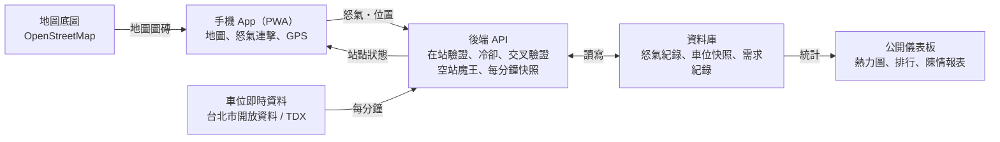

# 單車怒氣站 可行性報告

2026-10-19 · 名稱為暫定（repo 目前名為 bike-fighter）

## 摘要

這是一個讓使用者在 YouBike 站借不到車、還不了車時「按按鈕發洩怒氣」的 App，同時把這些怒氣變成各站供需不足的證據。技術上可行：站點與車位資料有公開的即時 API，地圖可用 OpenStreetMap，核心互動已經有可操作的網頁原型。

主要風險在數據可信度和多人統計需要後端。前者靠「在站驗證、連擊冷卻、即時資料交叉驗證」三道機制處理；後者是第二階段的主要工作。

## 問題與機會

尖峰時段的熱門站常常沒車可借或沒位可還，但這些「沒被滿足的需求」很少被記錄下來。

- **使用者端**：發現空站時通常已經在現場，只能生氣後走去下一站，沒有宣洩或反映的管道。
- **現有工具**：官方 App 只能查詢車位，不記錄「有多少人在這裡借不到」。
- **政策端**：開放資料只看得到車位數，看不到一個空站影響了多少人，擴站或加強調度缺少依據。

機會在於把情緒宣洩做成有趣的互動，讓使用者自願留下「我在這裡、我需要車」的紀錄。

## 產品定位與目標使用者

定位是「個人得到宣洩，城市得到需求數據」。宣洩怒氣是主功能，查車位是配套。

| 使用者 | 他們要什麼 | 從這個 App 得到什麼 |
| --- | --- | --- |
| 通勤通學的單車族 | 快速知道哪裡有車、有位 | 地圖、宣洩的爽感、替代站點 |
| 常常遇到同一個空站的人 | 讓問題被看見 | 累積的需求紀錄、一鍵陳情 |
| 市府、議員、研究者、媒體 | 哪些站需要擴充或調度 | 各站受影響人次、空站時長 |

## 核心機制：怒氣連擊

怒氣以「一批連擊」為單位送出，等級用對數計算，按 1,024 下是 Lv.10。

```
等級 = ⌊log₂(這批點擊數)⌋
```

| 規則 | 設定 | 目的 |
| --- | --- | --- |
| 連擊判定 | 每下間隔 ≤ 3 秒就是同一批，停手 3 秒送出 | 可以發 10 批 Lv.3，也可以一次發 Lv.7 |
| 誤觸 | 只按 1 下不送出 | 排除不小心碰到 |
| 冷卻 | 每批送出後 30 秒，換站也一樣 | 避免大量小批洗次數 |
| 不能連發 | 長按、按住鍵盤都只算 1 下 | 每一下都要真的按，數字才有說服力 |
| 速度上限 | 間隔不到 0.06 秒的點擊不算 | 擋掉連點程式 |

等級分四個階段：Lv.0–3 不爽、Lv.4–6 冒火、Lv.7–9 爆發、Lv.10 以上核爆，每升一級有特效、音效和震動。以一秒連點 8–10 下估算，Lv.10 大約要 1.5–2 分鐘。

統計可以在「怒氣等級」和「原始點擊次數」之間切換。等級和點擊數只當強度參考，需求量用「受影響人次」衡量。

## 在站驗證

只有「人真的在站點、站點當下真的沒車或沒位」的怒氣，才計入需求統計。

1. **地理圍欄**：要在站點 100 公尺內才能開始一批。
2. **中途離開**：這批還是可以打完送出，但下一批要回到站點才能發。
3. **連擊中鎖定**：不能換站或切換怒氣類型，避免在 A 站開始、送到 B 站。
4. **資料交叉驗證**：送出時記下 API 的車位數，當下有車的怒氣標為「未計入」。

正式版需要做成 App 或 PWA 才能用 GPS。GPS 可以被假造，後端應檢查兩次定位之間的移動速度是否合理。

## 限時討伐：空站魔王

站點一變成 0 輛車（或 0 個空位），就出現一場 10 分鐘的討伐；勝負看在場人數，不看等級。

| 項目 | 規則 |
| --- | --- |
| 出現條件 | 即時資料顯示 0 輛（空站魔王）或 0 位（滿站魔王） |
| 參戰 | 在站點送出一批 Lv.1 以上的怒氣 |
| 打倒條件 | 10 分鐘內 20 人參戰，每人只算 1 格 |
| 等級的用途 | 只影響個人排名、本場最高等級和特效 |
| 結束 | 時間到，或即時資料顯示恢復有車（有位） |
| 結果 | 自動留一筆需求紀錄 |

原本的想法是「10 分鐘內多少人達到 Lv.10」。但 Lv.10 要按 1,024 下，量到的是耐力，而趕時間、直接走掉的人會被漏掉，他們正是最該算進去的需求。改成算人數後，一場討伐就等於「這次空站影響了多少人」。

## 地圖與即時資料

站點位置與車位數有公開的即時資料可用，約每分鐘更新；調度紀錄則沒有公開。

| 來源 | 內容 | 需要金鑰 | 用途 |
| --- | --- | --- | --- |
| 台北市開放資料 YouBike 2.0 即時資料 | 站名、座標、可借車數、可還位數、更新時間 | 否 | 第一階段，只有台北 |
| TDX 運輸資料流通服務 | 多縣市站點與即時車位 | 是 | 擴展到其他城市 |
| OpenStreetMap | 地圖底圖 | 否 | 地圖顯示，需標示來源 |

- **地圖**：站點用顏色標示（紅 0、黃 1–3、綠 4 以上），可切換「看借車／看還車」，正在出魔王的站有脈動外圈。
- **調度推測**：一般還車是一台一台增加；一次更新就多 5 台以上，標為「疑似調度」。這是推測值，報表上要註明。
- **空站時長**：從變成 0 到恢復有車的時間，完全來自 API，與使用者等不等無關。

## 數據價值

最有價值的是「主觀的受影響人次」加上「客觀的空站時長」，兩者合起來就是一站的供需落差。

| 指標 | 算法 | 用途 |
| --- | --- | --- |
| 受影響人次 | 不重複使用者，每人每站每小時算 1 次，且通過在站與資料驗證 | 需求量的主指標 |
| 空站／滿站時長 | 由每分鐘快照計算 | 客觀的供給不足程度 |
| 恢復時間 | 變成 0 到恢復的分鐘數，含疑似調度標記 | 調度反應速度 |
| 站點 × 時段熱度 | 以上指標按星期、小時分組 | 哪個時段最缺車 |
| 怒氣等級、點擊數 | 各批的等級與點擊加總 | 只當強度參考、娛樂用 |

這些指標可以直接整理成陳情內容，例如「市政府站平日 8–9 點平均空站 25 分鐘，影響 23 人」。範例數字是虛構的。

## 延伸功能

以下功能不在第一階段，依類別列出。

- **社群**：戰友即時人數（「現在有 12 人跟你一樣在這站生氣」）、怒氣分享卡、每週最慘站排行、成就徽章。
- **消氣配套**：送出怒氣後立刻顯示最近有車（有位）的站和步行時間。
- **通知與預測**：關注的站有車時推播；用歷史資料預測通勤時段是否會空站。
- **社會影響**：一鍵陳情（整理數據可貼到 1999 或市長信箱）、公開儀表板、改善追蹤（「這站怒氣下降 60%」）。
- **吐槽牆**：每站留短句，需要關鍵字過濾與檢舉，可以最後再開放。

## 技術架構與可行性

技術上沒有卡關的部分：前端做成 PWA，所有驗證放在後端，資料來源都是公開的。



手機送出的只是「誰、在哪、按了幾下」，是否計入由後端對照快照決定，所以改前端程式也灌不了水。

- **前端**：PWA 開發最快；若需要穩定推播與背景定位，再考慮 Flutter 或 React Native。
- **後端**：Firebase、Supabase 或小型 Node 服務皆可；TDX 金鑰只放在後端。
- **即時人數**：戰友人數、討伐進度可用資料庫的即時訂閱實作。

## 法規授權與風險對策

沒有阻擋上線的法規問題，但名稱、資料來源標示和個資要一開始就做對。

| 風險 | 說明 | 對策 |
| --- | --- | --- |
| 商標 | 「YouBike」是註冊商標；「勇者鬥惡龍」是 Square Enix 的商標 | 名稱不用這兩個詞，只借用風格；聲明非官方 |
| 資料授權 | 政府開放資料可商用，但要標示來源；OSM 也要標示 | App 內固定顯示資料與地圖來源 |
| 個資 | 會收集位置 | 只在送出怒氣時取位置、匿名化、附隱私權政策 |
| 假造定位 | GPS 可被模擬 | 後端檢查移動速度、異常帳號降權 |
| 數據灌水 | 少數人狂按或大量小批 | 需求看人次不看點擊；冷卻、速度上限、不能連發 |
| 留言失控 | 謾罵、針對個人 | 關鍵字過濾、檢舉；可只開按鈕不開留言 |
| API 變動 | 欄位或網址可能改 | 後端統一轉接，前端不直接依賴 |

## 營運與商業模式

第一年以累積使用者與數據為主，收入來自數據與在地合作，不向使用者收費。

- **數據報告**：授權給市府、營運商、交通研究單位。
- **在地合作**：「生氣了？來杯飲料消氣」的周邊店家優惠。
- **品牌贊助**：分享卡上的贊助特效。
- **主要成本**：後端主機、每分鐘快照的儲存（台北約 1,500 站，全台約 1–2 萬站）、推播服務。實際金額還沒估算。

## 開發階段

分三個階段，每個階段有一個要驗證的問題。各階段的工時還沒估算。

1. **MVP：使用者會不會按、會不會分享**
    - 台北站點地圖、怒氣連擊與冷卻、GPS 在站驗證、分享卡
    - 做成 PWA，後端只處理登入與怒氣紀錄
2. **第二階段：數據站不站得住**
    - 多人共用資料庫、真實的空站魔王、每分鐘快照、熱力圖與排行
3. **第三階段：能不能帶來改變**
    - 改接 TDX 擴展多城市、公開儀表板、一鍵陳情、推播與預測

## 原型現況與待驗證事項

網頁原型 v0.4（本 repo 的 `index.html`）已完成連擊、冷卻、在站驗證、地圖與空站魔王；即時 API 尚未實測。

- 已實測：示範模式下的點擊、連擊送出、冷卻、點地圖選站。
- 仍是模擬：其他人的怒氣、討伐的路人、全站累積數字。

待驗證：

- [ ] 台北市即時 API 的欄位名稱與原型是否相符
- [ ] 該 API 是否允許網頁直接讀取（CORS），不允許就需要後端轉發
- [ ] 公開資料中確實沒有調度紀錄
- [ ] 在真實站點用 GPS 測試 100 公尺圍欄是否合理
- [ ] 30 秒冷卻與 20 人討伐門檻要用實際使用者調整

## 命名候選

五個候選都借用勇者、魔王、會心一擊這類 RPG 元素，但不使用「勇者鬥惡龍」或「YouBike」等商標。

| 名稱 | GitHub repo 名稱 | 咬合點 |
| --- | --- | --- |
| 勇者鬥空站 | `dock-quest` | 最直接的諧音；與原作名太像，正式上架前要請教法律 |
| 鐵馬勇者傳說 | `iron-horse-legend` | 「鐵馬」是台灣對單車的口語說法 |
| 空站魔王討伐隊 | `dock-boss-raid` | 直接對應限時討伐玩法 |
| 會心一擊！怒氣站 | `critical-rage` | 「會心一擊」是 RPG 的暴擊用語，對應狂按按鈕 |
| 怒氣冒險書 | `rage-quest` | 「冒險書」是 RPG 存檔的說法，對應需求紀錄 |
